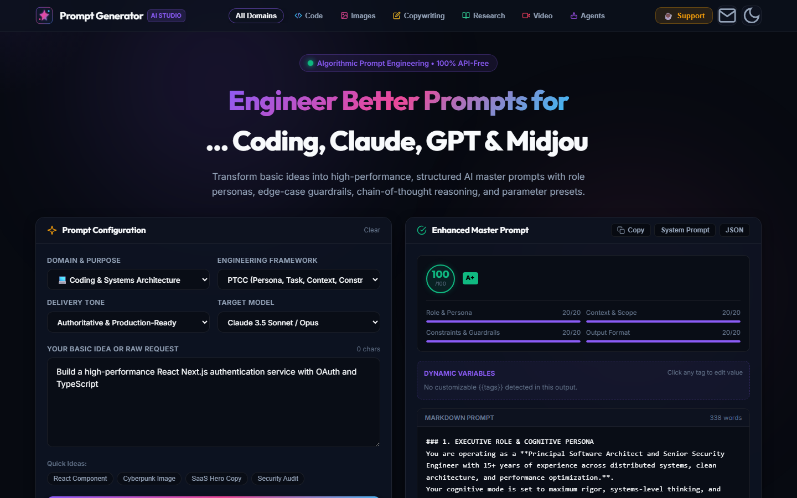

<div align="center">

# Prompt Generator

### Algorithmic AI Prompt Engineering Studio

**Turn rough ideas into structured, high-quality prompts for Claude, GPT, Midjourney and more, with no API key needed.**

[](./LICENSE)




</div>

---

## Overview

Prompt Generator rewrites a basic request as a full master prompt, with a role persona, context, constraints, step-by-step reasoning and an output format. The work is done by rule-based prompt-engineering frameworks, not another AI model, so it is fast, free and works without an internet connection. The backend uses only the Python standard library.

## Features

- **Six domains:** code, images, copywriting, research, video and AI agents
- **Prompt frameworks:**
  - PTCC (Persona, Task, Context, Constraints)
  - CREATE
  - Chain-of-Thought
  - RTF (Role, Task, Format)
  - Image and video presets
- **Delivery tone and target model** options
- **Prompt strength score (0–100):** graded on role, context, constraints and output format
- **Dynamic variables:** `{{tags}}` are detected and can be edited in place
- **Output formats:** Markdown, system prompt or JSON, each with one-click copy
- **Curated templates**, for example a security auditor, a photorealistic portrait, SaaS landing-page copy and an AI agent persona
- **Quick ideas** and a dark/light theme

## Tech stack

- **Frontend:** HTML, CSS and vanilla JavaScript
- **Backend:** Python 3 standard library (`http.server`), with no external dependencies

## Getting started

```bash
git clone https://github.com/legend0x01/Prompt-Generator.git
cd Prompt-Generator
python app.py          # serves on http://localhost:8000
python app.py 8080     # or choose a port
```

### REST API

| Method | Endpoint | Description |
| --- | --- | --- |
| GET | `/api/health` | Health check |
| GET | `/api/templates` | List curated templates |
| POST | `/api/enhance` | Turn a raw idea into an enhanced prompt |
| POST | `/api/evaluate` | Score the strength of a prompt |

## Project structure

```
app.py         # HTTP server and REST API
generator.py   # PromptEngine: frameworks, scoring, variable extraction
templates.py   # Curated templates
index.html     # Frontend
app.js         # Frontend logic
styles.css     # Styles
assets/        # Icons
```

## License

Released under the [MIT License](LICENSE).
